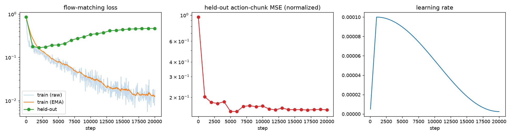
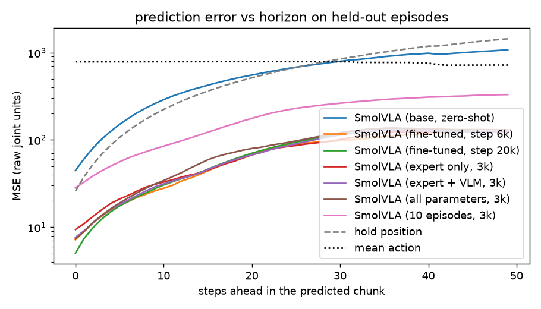
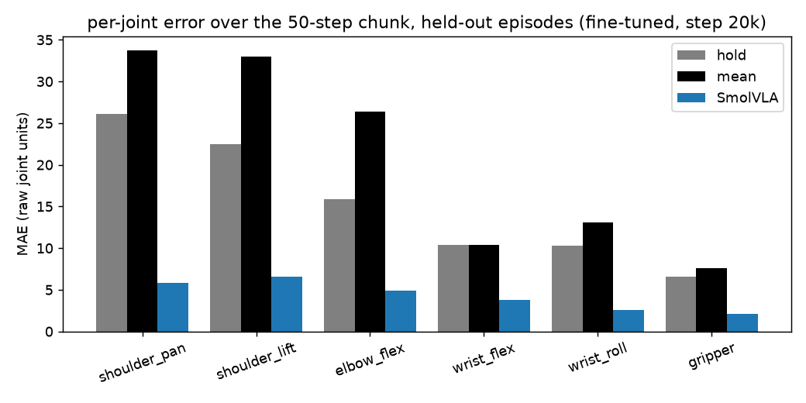
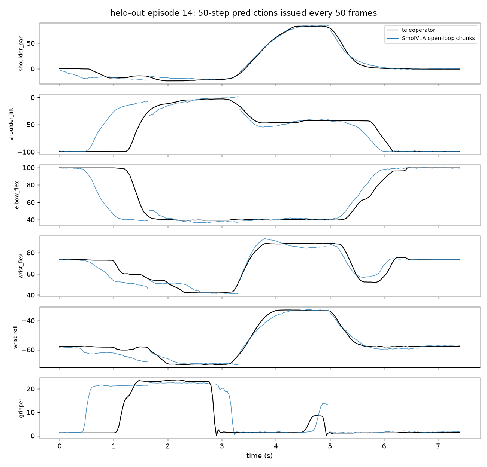
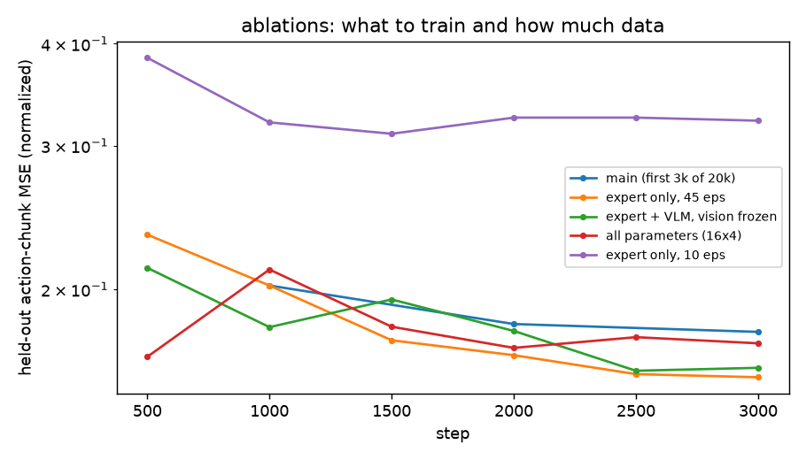

# SO-101 × SmolVLA

Imitation learning for a 6-DoF SO-101 arm, end to end: teleoperated recording, fine-tuning the
450M-parameter [SmolVLA](https://huggingface.co/lerobot/smolvla_base) vision-language-action policy
on one GPU, held-out evaluation against baselines, latency benchmarking, and closed-loop deployment
with per-trial success logging.

The headline run fine-tunes SmolVLA on the public
[`lerobot/svla_so101_pickplace`](https://huggingface.co/datasets/lerobot/svla_so101_pickplace)
dataset (50 episodes, 11,939 frames, "pink lego brick into the transparent box") on an RTX 5090.
On five held-out episodes the fine-tuned policy's 50-step action-chunk error is
**0.151** (normalized MSE) against **0.930** for the pretrained checkpoint
and **0.991** for holding the current pose. One observation-to-chunk inference takes
**109 ms** at batch size 1 (bf16), so with 50 actions per chunk the policy spends about 7% of
wall time computing at 30 Hz and can replan at most every fourth tick.



## Pipeline

```
so101 teleop ─▶ so101 record ─▶ so101 train ─▶ so101 eval ─▶ so101 bench ─▶ so101 deploy
 check the       LeRobot v3      SmolVLA         held-out        latency at      closed loop on
 control loop    dataset         fine-tune       chunk error     batch 1         the arm + logs
```

Everything is one package (`so101/`) with one CLI. Each stage is also an importable function,
and every number below is regenerated from JSON artifacts committed under `results/` by
`so101 report`.

## Results

### Held-out episodes

The dataset is split by episode with a fixed seed (45 train / 5 validation; validation episodes
1, 14, 28, 36 and 43). For every validation frame the policy predicts a 50-step action chunk from the
two camera images, the joint state and the task string; the chunk is compared with the teleoperator's
next 50 actions. "Norm." metrics are in the dataset's mean/std-normalized action space, "raw" in the
dataset's joint units (LeRobot's −100…100 range, gripper 0…100). Two baselines bracket the numbers:
repeating the current joint state for 50 steps, and emitting the dataset-mean action.

| Policy | Norm. MSE | Norm. MAE | Raw MAE | Raw MSE @1 | Raw MSE @50 |
|---|---|---|---|---|---|
| Hold last state | 0.991 | 0.640 | 15.28 | 25.9 | 1439.7 |
| Dataset mean action | 0.969 | 0.823 | 20.70 | 784.3 | 719.8 |
| SmolVLA base, zero-shot | 0.930 | 0.682 | 16.51 | 44.6 | 1075.4 |
| fine-tuned, best (step 6k) | 0.145 | 0.199 | 4.50 | 7.2 | 124.6 |
| fine-tuned, final (step 20k) | 0.151 | 0.191 | 4.29 | 5.0 | 123.6 |
| ablation: expert only, 3k | 0.154 | 0.209 | 4.71 | 9.4 | 122.8 |
| ablation: expert + VLM, 3k | 0.154 | 0.206 | 4.63 | 7.7 | 121.7 |
| ablation: all parameters, 3k | 0.171 | 0.217 | 4.81 | 7.3 | 130.6 |
| ablation: 10 episodes, 3k | 0.318 | 0.323 | 7.58 | 28.2 | 330.3 |

"Raw MSE @1" and "@50" are the first and last step of the chunk. The zero-shot base model is no
better than holding still: its language and vision pretraining does not transfer to this arm's
joint space without fine-tuning.

The step-6k and step-20k checkpoints are within noise of each other (both metrics depend on the
sampled flow-matching noise; the training-time validation at batch 64 reads 0.151 and 0.157 for the
same two checkpoints, the offline eval at batch 32 reads 0.145 and 0.151). The final checkpoint is
the one benchmarked and deployed below.

Held-out chunk MSE drops from 0.96 to 0.18 within the first 3k steps, reaches its minimum of
0.151 at step 6k, and then sits between 0.156 and 0.170 for the remaining 14k steps while the
held-out flow-matching loss climbs steadily (0.17 at step 2k to 0.47 at step 20k). With 45
training episodes the action expert starts memorising long before the schedule ends; the
`best/` checkpoint is therefore the step-6k one, `final/` scores 0.157 on the same validation pass, and a 6k to 10k step run
would have produced the same policy in a third of the time.

Error grows with horizon for every model, as it should for open-loop prediction, but the
fine-tuned policy stays below the hold-position baseline across the whole 50-step chunk:



Per joint, the largest absolute errors are on shoulder lift and shoulder pan (the joints that
move most during the reach); the gripper, which decides whether the brick is actually held, is
predicted to within 2.1 units of its 0 to 33 range on average:



On a held-out episode the open-loop chunks (blue, one issued every 50 frames with no feedback in
between) follow the teleoperator's trajectory (black) through the reach, grasp, carry and release.
The first chunk starts the reach and closes the gripper about half a second before this particular
operator did, which is the policy predicting the typical timing across the training episodes rather
than this operator's hesitation; the transport and release phases line up closely:



### Ablations

Four 3,000-step runs with the same data, seed and effective batch size, each with its own full warm-up and
cosine, compared with the first 3,000 steps of the main run (whose schedule is still near its peak
at that point). They vary what is trainable and how much data there is. One wrinkle worth knowing:
in lerobot's SmolVLA `train_expert_only=True` freezes the entire VLM including the vision tower, so
`freeze_vision_encoder` only has an effect once `train_expert_only` is off; the grid below reflects
that (an earlier "unfrozen vision" run with `train_expert_only` left on reproduced the expert-only
run bit for bit and was dropped).

| Run | Trainable params | Train episodes | Best held-out MSE (step) | Step time | Peak VRAM |
|---|---|---|---|---|---|
| main (first 3000 steps) | 99.9M | 45 | 0.177 (3000) | 0.47 s | 14.6 GB |
| expert_frozen | 99.9M | 45 | 0.156 (3000) | 0.47 s | 14.6 GB |
| full_vlm | 306.5M | 45 | 0.159 (2500) | 0.49 s | 18.2 GB |
| all_params | 392.9M | 45 | 0.165 (500) | 0.99 s | 20.5 GB |
| 10_episodes | 99.9M | 10 | 0.310 (1500) | 0.49 s | 14.6 GB |

Row names are the run directories under `results/ablations/`. `expert_frozen` is the main recipe
(action expert only, vision and VLM frozen); `full_vlm` also trains the VLM's language layers;
`all_params` trains everything including the vision tower, which does not fit at batch 64 and ran
as micro-batch 16 with 4-step accumulation (same effective batch; its step time and memory are for
that configuration, and its in-training validation used batch 16). "Best held-out MSE" is from the
in-training validation; the offline numbers for the final checkpoints are in the table above.



Three things come out of this grid:

- **Three thousand steps are enough.** The expert-only ablation, whose warm-up and cosine are
  compressed into 3k steps, reaches 0.154 offline against 0.151 for the 20k-step run, at a seventh
  of the cost. The main run's first 3k steps score worse (0.177) only because its learning rate is
  still near its peak at that point.
- **Unfreezing buys nothing and costs plenty.** Training the VLM's language layers as well
  (3× the trainable parameters, 25% more memory) matches expert-only at 0.154. Training everything
  including the vision tower is worse (0.171), plateaus around 0.17 from step 500 onward, and
  costs 2× the step time and 40% more memory even with accumulation. With 45 episodes the pretrained
  representations are the asset; the action expert is the only part worth moving.
- **Data is the lever.** Cutting the training set from 45 to 10 episodes doubles the error
  (0.318) with everything else fixed. The next most valuable hour on this project is spent
  recording demonstrations, not tuning the optimizer.

### Inference latency

Full path of the robot loop at batch size 1 on the RTX 5090: preprocessing, the 10-step
flow-matching denoiser that produces a 50-action chunk, and postprocessing. Median of 300
iterations after 30 warm-up iterations.

| Precision | p50 | p95 | max | Chunks / s |
|---|---|---|---|---|
| bf16 autocast | 108.8 ms | 110.3 ms | 118.2 ms | 9.2 |
| fp32 | 116.7 ms | 119.6 ms | 127.5 ms | 8.6 |

At 30 Hz a control tick is 33 ms, so a chunk costs between three and four ticks of latency. With
`n_action_steps = 50` the policy only needs a new chunk every 1.67 s, which is why the default
configuration runs in real time with margin, but it also means the arm executes 50 actions
open-loop between observations. Replanning more often (a shorter `n_action_steps`) is possible down
to roughly every 4 ticks, and no further without making inference faster. bf16 gains only 7% over
fp32 at batch size 1, which says the time is dominated by kernel launches across the 16-layer VLM
prefix and the 10 denoising steps rather than by arithmetic; CUDA graphs or `torch.compile` are
the obvious next step and are not applied here.

### On the robot

Offline chunk error is a proxy. The number that matters is the success rate of the closed-loop
policy on the physical arm, and it has to be counted, not estimated, so this repository ships the
tooling rather than a figure:

```bash
so101 deploy --checkpoint outputs/main/final --episodes 20 --use-degrees false
so101 deploy --summarize-only
```

`deploy` runs the policy at the camera rate, asks for a y/N verdict after each trial, appends one
JSON line per trial to `results/robot_trials.jsonl`, and `--summarize-only` turns that file into a
success rate with a 95% Wilson interval. Trials for the checkpoint above are not included in this
revision; when they are, the raw JSONL will be committed next to the number.

## Training recipe

| | |
|---|---|
| Base model | `lerobot/smolvla_base` (SmolVLM-2 500M backbone + flow-matching action expert, 450.0M params) |
| Trainable | action expert only, vision encoder frozen: 99.9M params (22%) |
| Data | 45 episodes, 10,691 frames, two 480×640 cameras (`up`, `side`), 6-D state, 6-D action, 30 fps |
| Targets | 50-step action chunks (`chunk_size = n_action_steps = 50`), padded past episode end and masked |
| Optimizer | AdamW (β 0.9/0.95, wd 1e-10), lr 1e-4, 1k linear warm-up, cosine to 2.5e-6 over 20k steps, grad-clip 10 |
| Precision | bf16 autocast with TF32 matmuls; fp32 master weights |
| Batch | 64; frames stay uint8 through the 12 loader workers and are scaled to float only at the policy input |
| Validation | every 1,000 steps on the 5 held-out episodes: fixed-seed flow-matching loss plus chunk MSE/MAE |
| Checkpoints | `best/` by held-out MSE, `step_*/` every 2k with optimizer and scheduler state for `--resume`, `final/` |
| Wall clock | 2 h 41 min on one RTX 5090 (0.47 s/step incl. data loading, 14.6 GB peak) |

Optimizer, schedule shape, clipping and chunking match the defaults in lerobot's `SmolVLAConfig`
and its documented 20k-step, batch-64 fine-tuning recipe. Two deliberate deviations: the cosine
decay ends at the last step rather than at the config's 30k, so the final checkpoint is trained at
the floor learning rate, and five episodes are held out, so there is a validation signal to pick a
checkpoint with (the upstream script trains on every episode).

## Reproduce

```bash
git clone https://github.com/aidxhxr/so-101 && cd so-101
python -m pip install -e ".[plots,dev]"      # torch, lerobot[dataset,smolvla], matplotlib, pytest, ruff
cp .env.example .env                        # set HF_TOKEN (needed only to push datasets or checkpoints)

so101 train --output-dir outputs/main --data.repo-id lerobot/svla_so101_pickplace          # ~2.6 h on a 5090
so101 eval  lerobot/smolvla_base outputs/main/final --out results/eval_offline.json         # held-out table
so101 bench --checkpoint outputs/main/final --out results/bench_bf16.json                   # latency
so101 trajectory --checkpoint outputs/main/final --episode 14 --out results/trajectory.json
so101 plot  --run-dir outputs/main --eval-json results/eval_offline.json --traj-json results/trajectory.json \
            --per-joint-checkpoint outputs/main/final
so101 report                                                                               # Markdown tables
```

The ablations are the same `train` command with `--steps 3000 --eval-every 500` and one of
`--train-expert-only false` (VLM trainable, vision frozen), `--train-expert-only false
--freeze-vision-encoder false` (everything trainable), or `--data.max-train-episodes 10`.
`make train eval bench plot` wraps the common path. Pass `--push-to-hub <user>/<name>` to `train`
to upload the final checkpoint with its pre/post-processors.

Resume an interrupted run with `so101 train --resume outputs/main/step_010000 --output-dir outputs/main`.

## Recording your own dataset

Hardware wiring, calibration, camera indices, the joint-unit pitfall introduced by lerobot 0.6,
and the on-robot trial protocol are in [docs/hardware.md](docs/hardware.md). The short version:

```bash
python -m pip install -e ".[robot,plots,dev]"
so101 teleop --seconds 30                          # {'loops': 900, 'late_fraction': 0.0}
so101 record --data.num-episodes 50                # pushes to $HF_USER/so101_pick_place
so101 train --data.repo-id $HF_USER/so101_pick_place --output-dir outputs/mine
so101 deploy --checkpoint outputs/mine/final --episodes 20
```

## Repository layout

```
so101/
  config.py        dataclass configs; .env / environment overrides; --flag generation
  hardware.py      SO-101 follower and leader construction (lerobot >= 0.6 layout, lazy imports)
  teleop.py        leader -> follower mirroring with late-tick accounting
  record.py        lerobot_record wrapper: episodes, reset time, resume, Hub push
  data.py          seeded episode split, uint8 image loading, infinite loader
  policy.py        SmolVLA construction from the pretrained checkpoint, processors, save/load
  schedule.py      warm-up + cosine multiplier
  metrics.py       padding-aware chunk MSE/MAE, hold and mean-action baselines
  train.py         the fine-tuning loop: logging, validation, best/periodic/final checkpoints, resume
  eval_offline.py  held-out scoring of checkpoints and Hub ids against both baselines
  trajectory.py    open-loop chunk dump for one episode (feeds the trajectory figure)
  bench.py         batch-1 latency of the full inference path
  robot_eval.py    closed-loop trials on the arm with JSONL logging and Wilson intervals
  plots.py         figures from the JSON/JSONL artifacts
  report.py        Markdown tables from results/
  cli.py           `so101 <command>`
results/           eval_offline.json, bench_*.json, trajectory*.json, main/ and ablations/ logs
docs/figures/      every figure in this README
tests/             29 CPU-only unit tests (split, schedule, metrics, config, report, Wilson interval)
```

## Configuration and secrets

`so101.config` loads `.env` with python-dotenv. `HF_TOKEN` is read only by `huggingface_hub` when
a dataset or checkpoint is pushed; nothing in this repository prints or stores it, and `.env` is
git-ignored. `HF_USER`, `SO101_FOLLOWER_PORT` and `SO101_LEADER_PORT` set the defaults that every
CLI flag can still override.

## Tests and CI

`ruff check` and `pytest` run on Python 3.10 and 3.12 on every push with CPU-only torch. The
tests cover the parts that are easy to get subtly wrong and cheap to check without a GPU: the
seeded split is deterministic, disjoint and always holds out at least one episode; the schedule
is linear to its peak and decays to its floor; padded chunk steps never leak into the error; the
running mean weights by batch size and skips empty batches; config dataclasses round-trip through
the CLI and `.env`; the report tables render from fixture logs; and the Wilson interval stays in
[0, 1] at 0 and n successes.

## References

- Shukor et al., *SmolVLA: A Vision-Language-Action Model for Affordable and Efficient Robotics*, 2025.
- Hugging Face [LeRobot](https://github.com/huggingface/lerobot) 0.6 and the
  [SO-101](https://github.com/TheRobotStudio/SO-ARM100) arm by The Robot Studio.
- Dataset: [`lerobot/svla_so101_pickplace`](https://huggingface.co/datasets/lerobot/svla_so101_pickplace).

Licensed under Apache-2.0.
